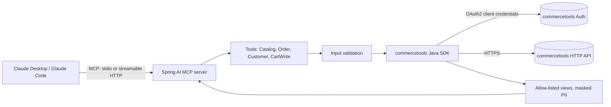

# commercetools MCP Server

**Ask Claude about your commercetools project in plain English: products, prices, stock, carts, orders and customers, read-only by default.**

[](https://github.com/Fayaz-Deen/commercetools-mcp-server/actions/workflows/ci.yml)
[](LICENSE)
[](https://adoptium.net/)
[](https://spring.io/projects/spring-boot)
[](https://modelcontextprotocol.io)

A [Model Context Protocol](https://modelcontextprotocol.io) server, written in Java with Spring AI and the
official commercetools Java SDK, that gives AI assistants such as Claude Desktop and Claude Code safe,
structured access to a [commercetools](https://commercetools.com) project.

---

## Demo

> The prompts below show typical questions. The tool output is an **example with synthetic data**, not
> taken from a real project.

```text
You     > Where is order ORD-10042 and what was in it?

Claude  → calls get_order { "orderNumber": "ORD-10042" }

Claude  > ORD-10042 was placed on 6 March 2026, is Confirmed, Paid and Shipped to Berlin, DE.
          It contains 1 x Trail Runner Shoe (TR-42-BLK) for 129.99 EUR.
```

<details>
<summary>Example tool result (synthetic)</summary>

```json
{
  "id": "b2c3d4e5-f6a7-4b8c-9d0e-1f2a3b4c5d6e",
  "orderNumber": "ORD-10042",
  "createdAt": "2026-03-06T10:20Z",
  "orderState": "Confirmed",
  "paymentState": "Paid",
  "shipmentState": "Shipped",
  "customerId": "d4c3b2a1-6f5e-4b7a-9d8c-5c4b3a2f1e0d",
  "customerEmail": "j***@example.com",
  "total": "129.99 EUR",
  "lineItems": [
    { "sku": "TR-42-BLK", "name": "Trail Runner Shoe", "quantity": 1, "unitPrice": "129.99 EUR", "total": "129.99 EUR" }
  ],
  "shipTo": "Berlin, DE"
}
```

</details>

More things you can ask:

| You ask | Tools Claude uses |
| --- | --- |
| "Find waterproof trail shoes and tell me which sizes are in stock." | `search_products`, `get_product` |
| "What does TR-42-BLK cost in Germany, and is it discounted?" | `get_price` |
| "How many TR-42-BLK do we have in warehouse-berlin?" | `get_inventory` |
| "Show the last 5 orders of jane.doe@example.com." | `list_recent_orders` |
| "Why is cart a1b2... so expensive? List its line items." | `get_cart` |
| "Which discount codes are active right now?" | `list_discount_codes` |
| "Show me the category tree under Shoes." | `list_categories` |

## Features

- **11 focused tools** for catalog, pricing, inventory, carts, orders, customers and discount codes.
- **Read-only by default.** The single write tool is only registered when `CT_MCP_ALLOW_WRITES=true`.
- **Concise JSON.** Every result is an allow-listed view: no SDK noise, no nulls, money as `"129.99 EUR"`,
  localized fields resolved to the locale you ask for.
- **Privacy by default.** Customer emails are masked (`j***@example.com`), last names reduced to an
  initial, addresses reduced to city and country. Password hashes, phone numbers and birth dates are never
  returned.
- **Validated inputs.** ids, keys, SKUs, emails, locales, currencies, countries and limits are checked before
  any API call. User values reach query predicates only as
  [predicate variables](https://docs.commercetools.com/api/predicates/query#input-variables), never by string
  concatenation.
- **Helpful errors.** A 403 tells the assistant which scope is missing; a 404 says what was not found.
- **Fail-fast config** with a clear message listing every missing `CTP_*` variable. Secrets are never logged.
- **Two transports:** stdio (default) and streamable HTTP (`http` profile, localhost only).
- **Tested without a live project:** the SDK's HTTP client is mocked, so the real SDK request builders and
  JSON parsing are exercised in every test.

## Quick start

### 1. Create a read-only API client

In the commercetools Merchant Center, go to **Settings > Developer settings > Create new API client** and pick
only the view scopes you need (see [Security](#security)). Keep the client id and secret at hand; the
Merchant Center can show them in an `.env` format that uses the same variable names as this server.

### 2. Build the jar

Requires JDK 21 or newer.

```bash
git clone https://github.com/Fayaz-Deen/commercetools-mcp-server.git
cd commercetools-mcp-server
./mvnw -q package -DskipTests
# -> target/commercetools-mcp-server.jar
```

### 3a. Claude Desktop

Add the server to `claude_desktop_config.json`
(macOS: `~/Library/Application Support/Claude/`, Windows: `%APPDATA%\Claude\`) and restart Claude Desktop:

```json
{
  "mcpServers": {
    "commercetools": {
      "command": "java",
      "args": ["-jar", "/absolute/path/to/commercetools-mcp-server.jar"],
      "env": {
        "CTP_PROJECT_KEY": "your-project-key",
        "CTP_CLIENT_ID": "your-client-id",
        "CTP_CLIENT_SECRET": "your-client-secret",
        "CTP_AUTH_URL": "https://auth.europe-west1.gcp.commercetools.com",
        "CTP_API_URL": "https://api.europe-west1.gcp.commercetools.com",
        "CTP_SCOPES": "view_products:your-project-key view_orders:your-project-key"
      }
    }
  }
}
```

### 3b. Claude Code

```bash
claude mcp add commercetools \
  -e CTP_PROJECT_KEY=your-project-key \
  -e CTP_CLIENT_ID=your-client-id \
  -e CTP_CLIENT_SECRET=your-client-secret \
  -e CTP_AUTH_URL=https://auth.europe-west1.gcp.commercetools.com \
  -e CTP_API_URL=https://api.europe-west1.gcp.commercetools.com \
  -- java -jar /absolute/path/to/commercetools-mcp-server.jar
```

Then run `claude mcp list` to check that it connected.

### 3c. Docker

```bash
docker build -t commercetools-mcp-server .
cp .env.example .env   # fill in your values; .env is git-ignored
```

Use it from Claude Desktop (the `-i` flag keeps stdin open for the stdio transport):

```json
{
  "mcpServers": {
    "commercetools": {
      "command": "docker",
      "args": ["run", "-i", "--rm", "--env-file", "/absolute/path/to/.env", "commercetools-mcp-server"]
    }
  }
}
```

### Optional: streamable HTTP transport

```bash
SPRING_PROFILES_ACTIVE=http java -jar target/commercetools-mcp-server.jar
# MCP endpoint: http://127.0.0.1:8080/mcp
```

The HTTP endpoint has **no authentication** and binds to `127.0.0.1` by default. Keep it on localhost or
put an authenticating proxy in front of it.

## Tool reference

| Tool | What it returns | Inputs | Scope needed |
| --- | --- | --- | --- |
| `search_products` | Matching published products with SKU, price, stock, image | `query`, `locale`?, `limit`? | `view_products` |
| `get_product` | One product with up to 25 variants, prices, availability, attributes | one of `id` / `key` / `sku`, `locale`? | `view_products` |
| `get_price` | The price commercetools selects for a SKU, including product discounts | `sku`, `currency`, `country`?, `locale`? | `view_products` |
| `list_categories` | Top-level categories, or the children of `parentId` | `parentId`?, `locale`?, `limit`? | `view_categories` |
| `get_inventory` | Stock per supply channel for a SKU | `sku`, `channelKey`? | `view_products` ¹ |
| `get_cart` | Cart state, line items, totals | `id`, `locale`? | `view_orders` |
| `get_order` | Order states, line items, totals, ship-to city | one of `id` / `orderNumber`, `locale`? | `view_orders` |
| `list_recent_orders` | Newest orders first, optionally for one customer email | `limit`?, `customerEmail`? | `view_orders` |
| `list_discount_codes` | Codes with validity, limits, cart predicate | `activeOnly`?, `limit`?, `locale`? | `view_discount_codes` |
| `get_customer` | Redacted customer profile | one of `id` / `email` | `view_customers` |
| `add_line_item_to_cart` ✍️ | Updated cart after adding a SKU | `cartId`, `sku`, `quantity`? (1-99) | `manage_orders` |

`?` marks optional inputs. `limit` is 1-50 (default 10). `locale` defaults to `en` and falls back to any
available translation. ✍️ is only available with `CT_MCP_ALLOW_WRITES=true`.

¹ With `channelKey`, the server first reads the Channel to resolve its id. If that call returns HTTP 403, give
the API client read access to Channels as well.

## Configuration

| Variable | Required | Default | Description |
| --- | --- | --- | --- |
| `CTP_PROJECT_KEY` | yes | | Project key |
| `CTP_CLIENT_ID` | yes | | API client id |
| `CTP_CLIENT_SECRET` | yes | | API client secret (never logged) |
| `CTP_AUTH_URL` | yes | | Auth URL of your region, e.g. `https://auth.europe-west1.gcp.commercetools.com` |
| `CTP_API_URL` | yes | | API URL of your region, e.g. `https://api.europe-west1.gcp.commercetools.com` |
| `CTP_SCOPES` | no | all scopes of the client | Space-separated scopes to request |
| `CT_MCP_ALLOW_WRITES` | no | `false` | Set to exactly `true` to register write tools |
| `SPRING_PROFILES_ACTIVE` | no | | `http` switches from stdio to streamable HTTP |
| `MCP_HTTP_ADDRESS` | no | `127.0.0.1` | Bind address for the `http` profile |
| `MCP_HTTP_PORT` | no | `8080` | Port for the `http` profile |

If a required variable is missing, the server stops at startup with a message such as
`Missing required environment variable(s): CTP_CLIENT_ID, CTP_CLIENT_SECRET`. See [`.env.example`](.env.example).

## Security

- **Read-only by default.** No tool can change data unless you set `CT_MCP_ALLOW_WRITES=true`. Any other
  value, including `yes` or `1`, keeps writes off.
- **Least-privilege API client.** Create a dedicated client with only the view scopes you need, for example
  `view_products`, `view_categories`, `view_orders`, `view_customers`, `view_discount_codes`. Even with writes
  enabled, the client can only do what its scopes allow; add `manage_orders` only if you want
  `add_line_item_to_cart`.
- **Personal data stays minimal.** Results are allow-listed views. Emails are masked and addresses reduced to
  city and country. Remember that the assistant still sees first names, order contents and totals.
- **Secrets.** Credentials come only from environment variables, are never logged, and are masked in
  `toString()`. `.env` is git-ignored.
- **stdio safety.** All logs go to stderr, so nothing corrupts the MCP protocol on stdout.
- **HTTP transport** has no authentication and binds to localhost by default.

Report vulnerabilities privately; see [SECURITY.md](SECURITY.md).

## Architecture



| Package | Responsibility |
| --- | --- |
| `config` | `CtpProperties` (fail-fast env config), `McpServerConfig` (SDK client, tool registration, write flag) |
| `tools` | `CatalogTools`, `OrderTools`, `CustomerTools`, `CartWriteTools`; `Inputs` (validation), `CtCalls` (error mapping), `Views` (concise result records) |

Built with Java 21, Spring Boot 3.5, Spring AI 1.1 (MCP server starter) and the commercetools Java SDK v2.

## Development

```bash
./mvnw verify      # compile, run all tests, build the jar
```

Tests use JUnit 5, AssertJ and Mockito. Each tool is tested against the real SDK with a mocked HTTP layer
and synthetic fixtures in `src/test/resources/fixtures`. No commercetools credentials are needed.

## Roadmap

- [ ] Support the newer [Product Search API](https://docs.commercetools.com/api/projects/product-search) as an
      alternative to Product Projection Search
- [ ] More read tools: shipping methods, payments, stores, product types, shopping lists
- [ ] Store-scoped (`in-store`) queries
- [ ] MCP resources and prompts (for example an "order health check" prompt)
- [ ] Authentication for the HTTP transport
- [ ] Prebuilt jar on GitHub Releases and an image on GitHub Container Registry
- [ ] Optional GraalVM native image for faster start-up

Ideas and votes are welcome in the issues.

## Contributing

Contributions are welcome. Please read [CONTRIBUTING.md](CONTRIBUTING.md) for the setup, how to add a tool,
and the commit conventions.

## Author

**Mohamed Fayaz Deen H**, Senior Technical Lead (Java, Spring Boot, commercetools)

- GitHub: [@Fayaz-Deen](https://github.com/Fayaz-Deen)
- LinkedIn: [fayaz-deen](https://www.linkedin.com/in/fayaz-deen-b1ba932b/)

If this project helps you, a star on GitHub is appreciated.

## License

[MIT](LICENSE) © 2026 Mohamed Fayaz Deen H

commercetools is a trademark of commercetools GmbH. This is an independent community project and is not
affiliated with or endorsed by commercetools.
